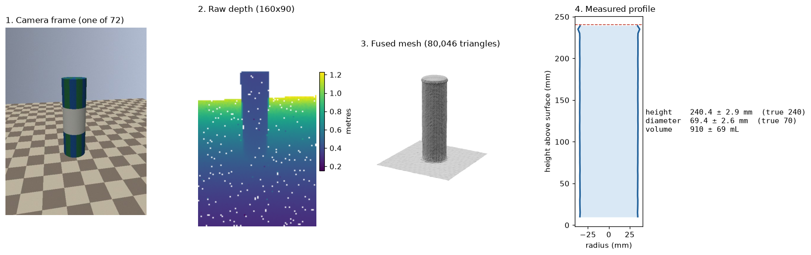
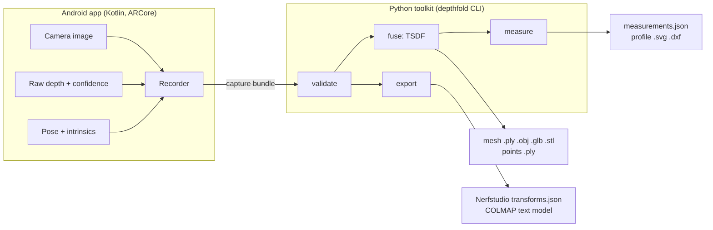

<div align="center">

# Depthfold

**Measure real objects with an Android phone, and export geometry you can actually use.**

[](https://github.com/rupeshbharambe24/depthfold/actions/workflows/ci.yml)
[](LICENSE)


[Quick start](#quick-start) · [How it works](#how-it-works) · [Accuracy](#accuracy) · [Roadmap](#roadmap) ·
[FAQ](#faq) · [Development](#development)

</div>



<sub>A real run of the toolkit on a synthetic capture of a 70 × 240 mm bottle. Regenerate with
`processing/scripts/render_readme_assets.py`.</sub>

Depthfold records what Google [ARCore](https://developers.google.com/ar) already knows on hundreds of millions of
Android phones (camera pose in metres, per-pixel depth with confidence, lens intrinsics) into an open
**capture bundle**. The app builds a 3D mesh from it **on the phone**, which you can view and share as GLB, STL or
PLY. A desktop toolkit adds a 2D profile drawing and a **measurement report in which every number carries its
units, an uncertainty and how it was obtained**.

Scan a bottle and you get its height, its diameter at every height, its volume, a DXF/SVG profile for CAD and a
mesh for Blender or a 3D printer. The raw capture is kept, so it can be re-processed later with better algorithms.

> [!IMPORTANT]
> **Alpha.** The app's capture and 3D model code is unit-tested and cross-checked against the toolkit, and the
> toolkit is tested end to end on synthetic captures, but **nothing has been tested on a physical phone yet**.

## Why

Open-source 3D reconstruction ([COLMAP](https://github.com/colmap/colmap), [Meshroom](https://github.com/alicevision/Meshroom),
[Open3D](https://github.com/isl-org/Open3D), [gsplat](https://github.com/nerfstudio-project/gsplat),
[Brush](https://github.com/ArthurBrussee/brush)) is excellent at shape. What is missing is the step after it:
**trustworthy, auditable measurements from an ordinary phone**.

- Closed scanning apps need LiDAR, leave scale unverified, or keep measurement behind a paywall.
- No permissively licensed Android app records raw ARCore depth together with poses and intrinsics in an open format.
- Nobody publishes how accurate phone measurements really are, per device.

Depthfold aims to fill those gaps in the open.

## What you get

| From one capture | Format | Use it in |
|---|---|---|
| Mesh, built on the phone | `.glb` `.stl` (mm) `.ply`, shared from the app | 3D viewers, Blender, slicers, CAD |
| Mesh | `.ply` `.obj` `.glb` `.stl` (mm) | Blender, MeshLab, web viewers, slicers for 3D printing |
| Point cloud | `.ply` | CloudCompare, Open3D, robotics |
| Measurement report | `measurements.json` | Your own code: values, units, 1-sigma uncertainty, method and provenance |
| 2D profile | `.svg` `.dxf` | CAD (FreeCAD, LibreCAD, AutoCAD), laser cutting, documentation |
| Camera poses | Nerfstudio `transforms.json`, COLMAP text model | Gaussian splatting, NeRF, photogrammetry refinement |
| The capture itself | capture bundle ([spec](docs/capture-bundle.md)) | Re-processing, datasets, benchmarks |

## How it works



1. **Record.** Walk slowly around the object. The app saves 1–8 frames per second: a JPEG, ARCore raw depth as a
   16-bit PNG in millimetres, its confidence image, the camera pose and the intrinsics of both images.
2. **Validate.** `depthfold validate` checks the bundle and reports tracking, depth coverage and stale frames.
3. **Fuse.** Depth is filtered by confidence and range, re-paired with the right pose when ARCore returns depth
   from an earlier frame, and fused into a TSDF volume. A mesh and point cloud are extracted.
4. **Measure.** The support surface is found by RANSAC with gravity as "up", the object is isolated, and
   dimensions are fitted: a gravity-aligned box, or for round objects a radius at every height.
5. **Export** to the formats above.

| Component | What it is | Docs |
|---|---|---|
| [`android/`](android/) | Kotlin + Jetpack Compose recorder on ARCore 1.57 | [android/README.md](android/README.md) |
| [`processing/`](processing/) | `depthfold` CLI and Python library (NumPy, Open3D, trimesh, ezdxf) | [processing/README.md](processing/README.md) |
| [`docs/capture-bundle.md`](docs/capture-bundle.md) | The bundle format: the contract between recorder and toolkit | spec v0.1 (draft) |
| [`scripts/interop-check.sh`](scripts/interop-check.sh) | Writes a bundle with the Android code and checks the toolkit reconstructs it | |

## Quick start

### Try the toolkit (no phone needed)

The toolkit can generate a synthetic capture of a known bottle, so you can see the whole pipeline in a minute.
You need [uv](https://docs.astral.sh/uv/).

```bash
git clone https://github.com/rupeshbharambe24/depthfold.git
cd depthfold/processing
uv sync
uv run depthfold synth -o demo/bottle                 # 70 mm x 240 mm cylinder on a floor
uv run depthfold validate demo/bottle
uv run depthfold fuse demo/bottle -o demo/fused       # mesh.ply / .obj / .glb / .stl, points.ply
uv run depthfold measure demo/bottle -o demo/measure  # measurements.json, profile.svg, profile.dxf
```

<details>
<summary>Example output of <code>depthfold measure</code></summary>

```text
Shape: cylinder
  height            240.41 mm  +/- 2.91  (median height above the support plane of 157 up-facing points on the flat top)
  diameter           69.39 mm  +/- 2.60  (2 x median slice radius over 10-90 % of height; ...)
  max_diameter       69.68 mm  +/- 2.61  (2 x largest slice radius over 10-90 % of height (slice at 115 mm))
  volume            909.98 mL  +/- 68.99  (integration of pi r(h)^2 over the slice radius profile ...)
```

</details>

### Record real captures

Build the app (JDK 17 and Android SDK platform 37) and install it on an
[ARCore-supported phone](https://developers.google.com/ar/devices), ideally one that supports the Depth API:

```bash
cd android
./gradlew assembleDebug
adb install app/build/outputs/apk/debug/app-debug.apk
```

Or download the debug APK from the [latest release](https://github.com/rupeshbharambe24/depthfold/releases)
(every push to `main` also builds one in [CI](https://github.com/rupeshbharambe24/depthfold/actions/workflows/ci.yml)).

Debug APKs from 0.2.1 on share one signing key, so they install over each other and keep your captures.

**Measure** in the live view gives a quick tape-measure distance: tap two points on an object or surface. In the
app, press **Record**, walk slowly around the object and press **Stop**. Then open **Captures**:

- **Build 3D model** fuses the depth on the phone (a few seconds), opens a 3D viewer (drag to rotate, pinch to
  zoom) and lets you share the mesh as GLB, STL (mm) or PLY.
- **Share zip** sends the whole capture to a computer, where you unzip it and run the same `validate`, `fuse` and
  `measure` commands on it.

## Accuracy

On synthetic captures with ARCore-like depth (160 × 90, distance-dependent noise, holes, stale depth frames and
non-tracking frames), the toolkit currently recovers:

| Object | Quantity | Truth | Error |
|---|---|---|---|
| Cylinder | diameter | 70 mm | −0.6 mm |
| Cylinder | height | 240 mm | +0.4 mm |
| Cylinder | volume | 924 mL | −1.4 % |
| Box | length / width / height | 180 / 110 / 75 mm | ±0.2 mm |
| Cylinder, smooth depth (no confidence) | diameter | 70 mm | −1.8 mm |
| Cylinder, 1 mm / 0.2° pose noise | diameter | 70 mm | −1.0 mm |
| Cylinder, mesh built by the phone code, measured by the toolkit | diameter / height | 70 / 240 mm | −0.7 / +0.4 mm |
| Box, mesh built by the phone code, measured by the toolkit | length / width / height | 180 / 110 / 75 mm | +0.1 / +0.1 / +0.2 mm |

**Real phones will be worse.** Published tests put single ARCore depth readings at centimetre level, so results
depend on fusing many frames, on the surface (transparent, shiny and dark objects defeat depth) and on the device.
Measuring this per device is the first item on the roadmap.

## Roadmap

| Status | Milestone |
|---|---|
| Done | Capture bundle spec v0.1, Android recorder, toolkit (`validate`, `fuse`, `measure`, `export`, `synth`), interop check, CI |
| Done | On-phone 3D model: depth fusion, 3D viewer, GLB / STL / PLY sharing (v0.2) |
| Next | **Real-device validation** on common phones (Samsung Galaxy A/M, Redmi Note, Pixel, OnePlus Nord), and fixes for what breaks |
| Planned | **Measurement report schema** as a stable, versioned JSON Schema |
| Planned | **Per-device accuracy benchmark**: reference objects, shared captures, public leaderboard |
| Planned | **More shape fits**: spheres, cones and tapered profiles, freeform profiles, flat outlines of planar parts |
| Planned | **More export formats**: USDZ, 3MF, E57, and glTF with real-world units and measurement annotations |
| Planned | On-phone measurements: box and cylinder dimensions and volume in the app |
| Planned | Optional detail refinement with photogrammetry or Gaussian splatting from the recorded poses |

## FAQ

<details>
<summary><b>Which phones work?</b></summary>

Any phone on Google's [ARCore supported devices list](https://developers.google.com/ar/devices) running Android 7.0
or later. Phones marked as supporting the **Depth API** give depth; Google reports that most active ARCore devices
do. Without depth, the app still records images and poses, which the `export` command can hand to photogrammetry
tools, but `fuse` and `measure` need depth.
</details>

<details>
<summary><b>Do I need a LiDAR or time-of-flight sensor?</b></summary>

No. Most phones estimate depth from motion, which is why you walk around the object. A depth sensor helps where
the phone has one and ARCore uses it.
</details>

<details>
<summary><b>What objects measure badly?</b></summary>

Transparent (glass bottles), mirror-like, very dark or textureless surfaces, thin parts below about 1 cm, and
anything that moves during the capture. Matte, rigid objects 10–100 cm across, recorded from 0.3–1.5 m, work best.
</details>

<details>
<summary><b>Why not iPhone?</b></summary>

iPhone already has strong capture apps and open recorders such as Stray Scanner. Android, where most phones in many
countries are, does not have an open raw-depth recorder. The bundle format is not Android-specific, so an iOS
recorder could read and write it later.
</details>

<details>
<summary><b>Does anything leave my phone?</b></summary>

No. Recording, depth and tracking run on the device, and captures stay in the app's storage until you share them.
Depthfold does not use ARCore's cloud features.
</details>

<details>
<summary><b>Can I use it commercially?</b></summary>

Yes. Depthfold is Apache-2.0 and its core dependencies are permissively licensed. ARCore itself is provided by
Google under its own terms.
</details>

## Development

Depthfold is in early, focused development: the core capture, model and measurement pipeline comes first, and
outside code contributions will be opened up once it is stable on real phones. Until then, bug reports and
questions are welcome in [Issues](https://github.com/rupeshbharambe24/depthfold/issues) and
[Discussions](https://github.com/rupeshbharambe24/depthfold/discussions); please open an issue before starting any
pull request. [CONTRIBUTING.md](CONTRIBUTING.md) explains how to build and test both parts. Everyone taking part
follows the [Code of Conduct](CODE_OF_CONDUCT.md).

## Citing

If Depthfold helps your research, please cite it using the metadata in [CITATION.cff](CITATION.cff)
(GitHub's "Cite this repository" button).

## License

[Apache License 2.0](LICENSE). ARCore is provided by Google under its own terms; apps built with it follow the
[ARCore privacy requirements](https://developers.google.com/ar/develop/privacy-requirements).
